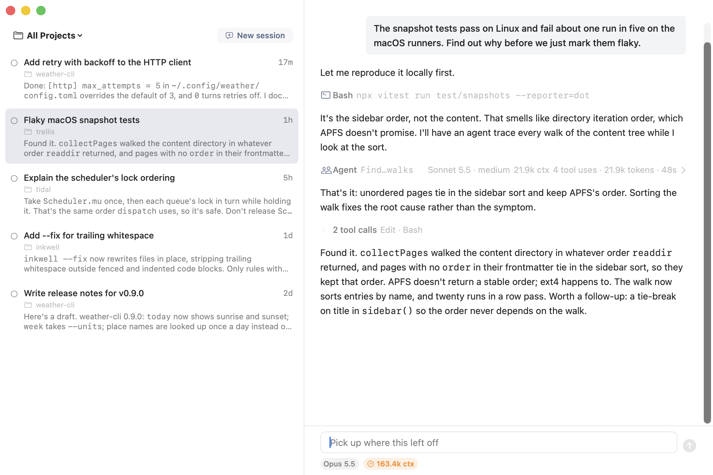

# Dex

A macOS GUI for Claude Code sessions.



## Why Dex?

I started out using Claude Code in the terminal like everyone else, thought `claude agents` was cool but wanted a way to consistently see all my sessions at once/see if one was waiting, started building a GUI wrapper for that, and ended up with a fairly feature-complete coding harness!

Frankly, Dex can't really do all that much beyond what Claude Code can do in the Claude desktop app, but it's nice to be able to fully customize the UI and to integrate with my other personal tools as seamlessly as possible.

I aim to keep Dex's scope as limited as possible to limit maintenance burden -- if I'm not using a feature in Dex, I'll usually just remove it.

## Project status

**NOTE: This repository is currently a read-only public export of my private internal Dex repo.** My personal version of Dex contains a bunch of integrations with my other personal tools that don't make sense to make public (and are difficult to add purely via something like plugins), so this setup was the easiest way to open-source Dex.

Feature requests, bug reports, or any other feedback is very welcome, though! I plan to export daily updates from my private repo.

But also this is 2026, so I expect the best way to use Dex for most people will be to operate their own fork with their customizations (that automatically pulls in changes from upstream, if you want automatic updates for new versions of Claude Code and any other updates I make).

## Using Dex

Dex requires an Anthropic API key. It uses `ANTHROPIC_API_KEY` from your login shell if it's set there, or you can paste a key into Settings.

### Run a pre-built binary

Builds are available in [Releases](https://github.com/ericbomgardner/dex/releases).

### Build and run from source

System requirements:
- macOS 15+ on Apple silicon
- Xcode 16+
- Node 22.18+

Dex must be signed with a code signing certificate. A self-signed one is sufficient -- create one in Keychain Access: Certificate Assistant → Create a Certificate, with Identity Type "Self Signed Root" and Certificate Type "Code Signing", then add its name to your shell profile (e.g. ~/.zshrc) like:
```bash
export DEX_CODESIGN_IDENTITY="<the certificate's name>"
```

To build and open Dex:
```bash
Scripts/make-app.sh
open .build/Dex.app
```

## Claude Code compatibility

Most of Dex's interactions with Claude Code (transcript records, SDK events, CLI output) are not through a documented interface, so Claude Code's behavior can change without notice between versions. `docs/claude-code/` tracks observations about Claude Code's behavior, including the CLI version each observation was checked against and a probe for re-checking it.

Sessions use the `claude` bundled with the SDK version pinned in `Sidecar/package.json`.

## License

MIT. See `LICENSE`.
